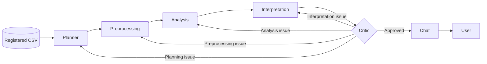

# Autonomous Data Analysis

Upload a CSV, ask a question, and explore calculated results, tables, and charts
through a conversational interface. LangGraph coordinates planning, deterministic
preprocessing and analysis, interpretation, Critic review, and the final response.

## What you can do

- Preview and validate CSV uploads up to 10 MB.
- Clean data while preserving the original dataset.
- Calculate descriptive statistics, grouped summaries, correlations, and
  categorical counts.
- Create bar, line, scatter, histogram, box, and heatmap charts.
- Inspect the plan, transformations, evidence, warnings, and review.
- Ask follow-up questions or request new calculations in the same conversation.

The current application supports CSV input and descriptive analysis. Database
connectors and machine learning workflows are not implemented. Critic review
checks evidence and methodology; it does not guarantee that every conclusion is
correct.

## Quick start

You need Git, Python 3.12 (3.12.13 is the documented setup),
[uv](https://docs.astral.sh/uv/getting-started/installation/) 0.11.21 or compatible,
and Node.js 22.12 or newer with npm. Live analysis also requires a valid
NTNU/IDUN model API key and access to the endpoint, which may require NTNU VPN.

```bash
git clone https://github.com/CogitoNTNU/autonomous-data-analysis.git
cd autonomous-data-analysis
uv sync --project backend
npm --prefix frontend ci
```

Create a `.env` file at the repository root (ignored by Git):

```dotenv
NTNU_LLM_API_KEY=your-key
NTNU_LLM_BASE_URL=https://llm.hpc.ntnu.no/v1
NTNU_LLM_MODEL=openai/gpt-oss-120b
```

Start the backend:

```bash
uv run --project backend --env-file .env python -m backend.app.api.planner_server
```

In a second terminal, from the repository root, start the frontend:

```bash
npm --prefix frontend run dev -- --port 5173 --strictPort
```

Open [http://localhost:5173](http://localhost:5173). Upload
`backend/data/demo_sales/sales_dirty.csv` and try:

> Remove duplicate rows, summarize revenue and profit, and show a histogram
> of revenue. Leave other values unchanged.

See [Running the project](RUNNING.md) for the full demo, command-line tools,
troubleshooting, and model configuration. The browser conversation currently
clears on reload; the Recent list does not restore saved runs. Backend datasets
and checkpoints persist locally. Deployment requires a persistent backend.

## How it works



The Planner uses validated, read-only inspection tools to build a typed plan.
Preprocessing and Analysis execute registered deterministic tools. Interpretation
explains calculated evidence, and Critic checks the draft. LangGraph owns shared
state, targeted revisions, retries, clarification interrupts, and execution limits.
For mixed Critic issues, it returns to the earliest affected stage and reruns its
dependents. Chat presents approved results and handles follow-up conversation;
requests for new calculations return to Planner in a new analysis round.

## Development and checks

Install the contributor hooks:

```bash
uv run --project backend pre-commit install --config .config/pre-commit-config.yaml
```

Run checks without model credentials:

```bash
uv lock --project backend --check
uv run --project backend pytest -q backend/tests
npm --prefix frontend run typecheck
npm --prefix frontend test
npm --prefix frontend run build
```

## Project structure and documentation

| Location                                      | Purpose                                                |
| --------------------------------------------- | ------------------------------------------------------ |
| [RUNNING.md](RUNNING.md)                      | Setup, demos, tests, and troubleshooting               |
| [backend/](backend/README.md)                 | Workflow API, persistence, and model settings          |
| [frontend/](frontend/README.md)               | React and TypeScript client                            |
| [backend/app/](backend/app/)                  | Contracts, graph, agents, tools, services, and storage |
| [backend/tests/](backend/tests/)              | Backend unit and integration tests                     |
| [backend/data/](backend/data/)                | Example datasets and local generated data              |
| [backend/scripts/](backend/scripts/README.md) | Model evaluation and workflow smoke tests              |
| [docs/](docs/index.md)                        | MkDocs overview and generated API reference            |
| [.config/](.config/)                          | Shared development checks                              |

## Team

<table>
  <tr>
    <td align="center"><br><b>Kien Parajes Le</b></td>
    <td align="center"><br><b>Sebastian Jøranger</b></td>
    <td align="center"><br><b>Kristoffer</b></td>
    <td align="center"><br><b>Daniel Samoylov</b></td>
  </tr>
</table>

## License

[MIT](LICENSE)
