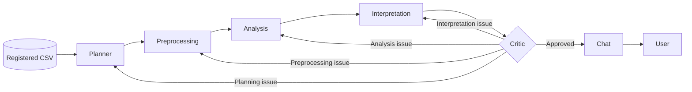

# Autonomous Data Analysis

Upload a CSV and ask questions through a React interface. LangGraph coordinates
planning, deterministic preprocessing and descriptive analysis, interpretation,
Critic review, and conversational presentation of results and charts.

## Current capabilities

The application supports CSV uploads up to 10 MB, immutable source datasets,
cleaning, descriptive statistics, grouped summaries, correlations, categorical
counts, and six chart types. Follow-up messages can explain recorded results or
start a new analysis round. Database connectors and machine learning workflows
are not implemented.

## Workflow

LangGraph bounds retries and revisions, handles clarification, and stores
checkpoints. Critic revisions return to the earliest affected stage and rerun
its dependents. Chat can route follow-up requests for new calculations back to
Planner in a new analysis round.

## Guides

The repository's root `README.md` provides the quick start. `RUNNING.md` covers
setup, demos, tests, and troubleshooting; `backend/README.md` documents the API,
persistence, and model settings. Client development is described in
`frontend/README.md`, and `backend/scripts/README.md` covers evaluations and smoke
tests. These guides are maintained alongside the source in the repository.

See [Descriptive charts and grouped results](charts.md) for chart presentation,
aggregation counts, and interpretation limits.

The browser conversation clears on reload, and the Recent list does not restore
saved runs. Backend datasets and checkpoints persist locally. Deployment requires
a persistent backend. The generated API reference documents Python modules;
use the repository guides above for application setup.
